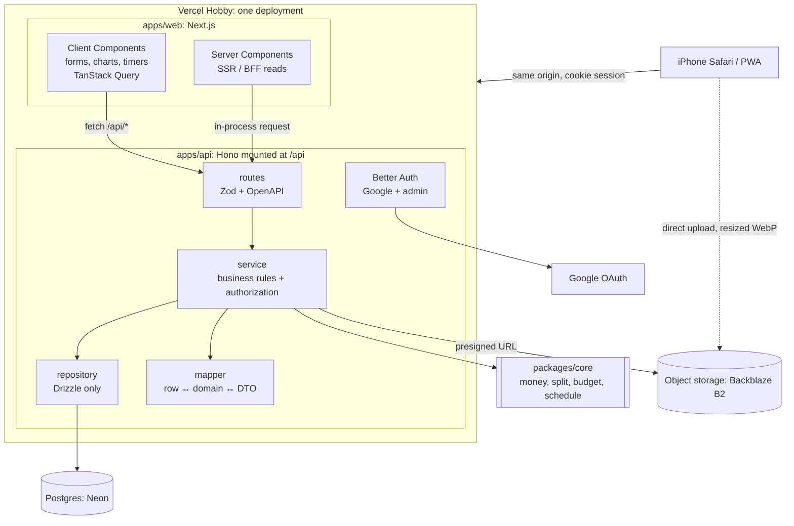

# iPlan

A mobile-first web app for **planning trips** with friends (itinerary across time zones, live "today" view, checklists, shared expenses and who-owes-whom) and **tracking monthly money** (salary, deductions, fixed costs, one-off spending, slips, budgets and charts).

> Status: early development. This README grows with each Pull Request; sections marked _(planned)_ land in later PRs.

## Stack

| Layer    | Choice                                                                                                                        |
| -------- | ----------------------------------------------------------------------------------------------------------------------------- |
| Monorepo | Turborepo + Yarn 1.22 workspaces, TypeScript strict                                                                           |
| Web      | Next.js (App Router), Tailwind CSS v4, shadcn/ui, TanStack Query, React Hook Form + Zod, Recharts, next-intl (Thai / English) |
| API      | Hono with Zod + OpenAPI, Better Auth (Google sign-in, admin roles)                                                            |
| Data     | PostgreSQL with Drizzle ORM                                                                                                   |
| Files    | Any S3-compatible storage (MinIO locally, Backblaze B2 in production)                                                         |
| Tests    | Vitest; Playwright smoke tests _(planned)_                                                                                    |
| Hosting  | Vercel Hobby (web + API), Neon (Postgres), Backblaze B2 (files): all free, no card                                            |

## Project structure

```
iPlan/
├─ apps/
│  ├─ web/          Next.js UI (mobile-first, th/en); serves the API at /api/*
│  └─ api/          Hono app: modules/<m>/{routes,service,repository,mapper}
├─ packages/
│  ├─ config/       Shared tsconfig and ESLint config
│  ├─ core/         Pure domain logic: money, split, budget, schedule, time zones
│  ├─ db/           Drizzle schema, migrations, demo seed
│  ├─ contracts/    Zod request/response schemas and error codes
│  └─ i18n/         Locales and Intl formatters (Buddhist era for Thai)
├─ docs/            HANDOFF.md (background), INFRA.md (accounts, secrets)
└─ .github/workflows/ci.yml
```

## Architecture



Why this shape:

- **Clear layers without extra servers.** The API is its own package and never imports Next.js, but it runs inside the same Vercel deployment. Web and API share one origin, so the session cookie is first-party. iPhone Safari blocks third-party cookies, which would break login if the API sat on a different free domain.
- **Business rules live in one place.** Routes validate, services decide (including who may do what), repositories only query, mappers only convert. Pure calculations sit in `packages/core` and are unit-tested.
- **Money is exact.** Amounts are integer minor units (`bigint`), each expense stores the FX rate used, and the UI shows the original currency plus THB.
- **Storage is swappable.** Code talks to an S3-compatible interface and the database stores object keys, so moving providers means copying files and changing environment variables.

## Run locally

Requirements: Node 22 (`.nvmrc`), Yarn 1.22 (`npm i -g yarn@1.22.22`), Docker (Docker Desktop, OrbStack or Colima).

```bash
yarn install
cp .env.example .env
yarn db:setup       # Postgres in Docker + migrations + demo data
yarn dev            # http://localhost:3000, API docs at /api/docs
```

Tap **Dev login** on the sign-in page (no Google account needed locally).

### What to try (demo)

The seed creates a fictional **Seoul (demo)** trip that starts yesterday, so today is the arrival day in Seoul.

| Screen             | Try                                                                                                                                    |
| ------------------ | -------------------------------------------------------------------------------------------------------------------------------------- |
| **Trips**          | Trips grouped into On the trip / Upcoming / Past; ➕ creates a trip                                                                    |
| **Trip**           | Swipe the day tabs; times show in each item's own zone (Bangkok → Seoul); tap an item to edit, duplicate or delete; ➕ adds an item    |
| **Today**          | What's on now with a progress bar, time left, countdown to the next item, **Check in** (shows minutes ahead/behind plan), day progress |
| **Time simulator** | Flask button on Today: jump ±1h, +1 day or to the next item to see the live view at any moment of the trip                             |
| **Settings**       | Thai / English, System / Light / Dark                                                                                                  |

Sign in as **Demo Friend** to see the same trip with the _editor_ role. `yarn db:seed` resets the demo data.

**On your iPhone:** connect to the same Wi-Fi, then open the "Network" URL that `yarn dev` prints (e.g. `http://192.168.1.20:3000`). Add it to the Home Screen from the Share menu for the full-screen app. Local network origins are trusted only outside production.

## Scripts

| Command                             | What it does                            |
| ----------------------------------- | --------------------------------------- |
| `yarn dev`                          | Web app + API on http://localhost:3000  |
| `yarn build`                        | Build all packages and apps             |
| `yarn lint`                         | ESLint in every package                 |
| `yarn typecheck`                    | `tsc --noEmit` in every package         |
| `yarn test`                         | Vitest in every package                 |
| `yarn format` / `yarn format:check` | Prettier write / check                  |
| `yarn validate`                     | Everything CI runs                      |
| `yarn db:setup`                     | Start Postgres, migrate, seed demo data |
| `yarn db:generate`                  | New migration after editing the schema  |
| `yarn db:seed`                      | Reset demo data                         |
| `yarn db:down`                      | Stop local Postgres                     |

## Deploy _(planned)_

Vercel builds the Next.js app (which includes the API), Neon provides Postgres, Backblaze B2 stores files. Step-by-step setup and every environment variable are in [docs/INFRA.md](docs/INFRA.md).

## Free-tier notes

- No service has a card on file, so nothing can be billed; over-quota services pause or throttle instead.
- Vercel Hobby is for personal, non-commercial use.
- Neon scales to zero when idle; the first request after a pause takes about a second longer.
- Backblaze B2 gives 10 GB. Photos are resized in the browser before upload (about 150–400 KB each), which fits tens of thousands of images.

## Contributing

- Branch off `develop`, open a Pull Request into `develop`. Nothing is pushed to `main` directly.
- Conventional Commits (`feat:`, `fix:`, `chore:`, `docs:` ...).
- CI must be green: format, lint, typecheck, test, build.
- Never commit secrets or personal data; this repository is public.

## License

[MIT](LICENSE)
