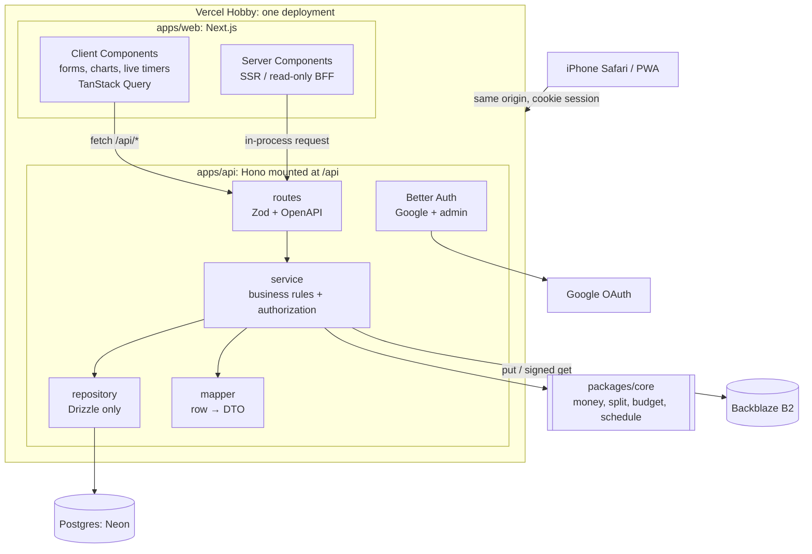

# iPlan

A mobile-first web app for **planning trips** with friends and **tracking monthly money**, in Thai and English.

- **Trips:** day-by-day plan across time zones, a live "Today" view with check-ins, members and invite links, a shared checklist, info cards, expenses with splits and who-pays-whom, slips and photos, calendar export, backup and import.
- **Money:** salary and payslip deductions (tax, social security, provident fund), fixed costs, one-month adjustments, one-off spending, category budgets, charts.
- **Admin:** users, roles, suspensions, audit log and usage stats.

Built to run entirely on free tiers with no credit card on file.

## Stack

| Layer    | Choice                                                                                                       |
| -------- | ------------------------------------------------------------------------------------------------------------ |
| Monorepo | Turborepo + Yarn 1.22 workspaces, TypeScript strict                                                          |
| Web      | Next.js 16 (App Router), Tailwind CSS v4, TanStack Query, Zod, next-intl (Thai / English), plain SVG charts  |
| API      | Hono with Zod + OpenAPI (Scalar docs), Better Auth (Google sign-in, admin plugin, dev-only login)            |
| Data     | PostgreSQL 17 with Drizzle ORM and SQL migrations                                                            |
| Files    | `StorageProvider`: local disk in development, any S3-compatible bucket in production (Backblaze B2)          |
| Exports  | Excel via `write-excel-file` (loaded on demand), PDF via print pages, CSV, `.ics`, JSON backup               |
| Tests    | Vitest (domain logic, every API service with in-memory repositories, HTTP tests)                             |
| Hosting  | Vercel Hobby (web + API in one deployment), Neon (Postgres), Backblaze B2 (files), Google Cloud (OAuth only) |

## Project structure

```
iPlan/
├─ apps/
│  ├─ web/                      Next.js UI; serves the API at /api/*
│  │  ├─ app/(app)/             signed-in screens (trips, today, money, settings, admin, showcase)
│  │  ├─ app/print/             print-friendly pages for PDF export
│  │  ├─ app/api/[[...route]]/  mounts the Hono app
│  │  ├─ components/            UI by feature (trips, money, admin, charts, ui)
│  │  ├─ lib/                   API client, query hooks, image compression, Excel, formatters
│  │  └─ messages/{th,en}.json  every UI string (CI checks both have the same keys)
│  └─ api/                      Hono app, never imports Next.js
│     └─ src/modules/<module>/  <m>.routes.ts → <m>.service.ts → <m>.repository.ts, <m>.mapper.ts
│        me, trips, items, members, checklist, info-cards, expenses, attachments,
│        finance, admin, backup
├─ packages/
│  ├─ core/        pure domain logic: money (bigint), splits and settlement, budgets, schedule, time zones
│  ├─ db/          Drizzle schema, migrations, demo seed, legacy prototype converter
│  ├─ contracts/   Zod request/response schemas and error codes shared by web and API
│  ├─ i18n/        locales and formatters (dates, months, money; Buddhist era for Thai)
│  └─ config/      shared tsconfig and ESLint config
├─ docs/           HANDOFF.md (background), INFRA.md (accounts, secrets, quotas)
└─ .github/workflows/ci.yml
```

## Architecture



Why this shape:

- **Clear layers without extra servers.** The API is its own package, but it runs inside the same Vercel deployment as the pages. Web and API share one origin, so the session cookie is first-party; iPhone Safari would block it if the API lived on a different free domain.
- **Rules live in one place.** Routes validate input, services decide (including who may do what), repositories only query, mappers only convert. Calculations are pure functions in `packages/core`.
- **Money is exact.** Amounts are integer minor units (`bigint`); every expense keeps the exchange rate it was converted with; screens show the original currency and THB.
- **Time is unambiguous.** Instants are stored in UTC with an IANA zone per plan item, so a 02:25 Bangkok departure and a 10:00 Seoul arrival both read correctly.
- **Files are private.** Photos are resized in the browser (slips 2000 px, photos 1600 px, plus a 400 px thumbnail, EXIF and GPS removed) and uploaded through the API, which checks the file's real type. Downloads go through a permission check; in production the API answers with a 5-minute signed B2 URL.
- **Text is the same everywhere.** Dates, times and money are formatted from fixed tables instead of `Intl`, because Node and browsers ship different Thai data, which would break server-rendered pages.

## Run locally

Requirements: Node 22 (`.nvmrc`), Yarn 1.22 (`npm i -g yarn@1.22.22`), Docker (Docker Desktop, OrbStack or Colima). No cloud accounts are needed.

```bash
yarn install
cp .env.example .env
yarn db:setup       # Postgres in Docker + migrations + demo data
yarn dev            # http://localhost:3000, API docs at /api/docs
```

Tap **เข้าเป็น Demo Owner** (Dev login) on the sign-in page. Then open **Settings → All features** (`/showcase`): it links to every feature in the demo data.

**On your iPhone:** join the same Wi-Fi and open the "Network" URL that `yarn dev` prints (e.g. `http://192.168.1.20:3000`). Share → Add to Home Screen gives the full-screen app.

### Demo data

`yarn db:seed` (re)creates fictional data:

| What                | Details                                                                                        |
| ------------------- | ---------------------------------------------------------------------------------------------- |
| Users               | Demo Owner (`dev@iplan.local`, admin) and Demo Friend (`friend@iplan.local`)                   |
| Trip "Seoul (demo)" | Starts yesterday so today is the arrival day: plan, check-ins, checklist, info cards           |
| Trip expenses       | THB and KRW expenses with equal and exact splits, a shared pool, a KRW rate and a daily budget |
| Monthly money       | Payslip lines, fixed costs, a bonus month, six months of one-off spending, category budgets    |

### Bring over the old prototype trip

```bash
yarn legacy:convert legacy/seoul-trip.html [seoul26-backup.json] > ~/seoul.iplan.json
```

Then **Trips → Import trip from file**. The converter reads the prototype's built-in plan, checklist and info cards plus your edits from its "Backup JSON" file. It runs locally; the output contains personal bookings, so keep it out of git.

## Scripts

| Command                             | What it does                                             |
| ----------------------------------- | -------------------------------------------------------- |
| `yarn dev`                          | Web app + API on http://localhost:3000                   |
| `yarn validate`                     | Everything CI runs: format, lint, typecheck, test, build |
| `yarn build`                        | Build all packages and apps                              |
| `yarn lint` / `yarn typecheck`      | ESLint / `tsc --noEmit` in every package                 |
| `yarn test`                         | Vitest in every package                                  |
| `yarn format` / `yarn format:check` | Prettier write / check                                   |
| `yarn db:setup`                     | Start Postgres, migrate, seed demo data                  |
| `yarn db:generate`                  | New migration after editing `packages/db/src/schema.ts`  |
| `yarn db:migrate` / `yarn db:seed`  | Apply migrations / reset demo data                       |
| `yarn db:studio`                    | Browse the database in Drizzle Studio                    |
| `yarn db:down`                      | Stop local Postgres                                      |
| `yarn legacy:convert`               | Convert the old prototype into an importable trip file   |

## API

Every endpoint is described at **`/api/docs`** (OpenAPI 3.1, raw document at `/api/openapi.json`). Errors always look like:

```json
{
  "error": {
    "code": "VALIDATION_FAILED",
    "message": "Invalid input",
    "fields": { "endDate": "..." }
  }
}
```

The web app translates `code` into Thai or English. Authorization happens in the services: trip data needs membership (viewer / editor / owner), personal finance is visible to its owner only, admin endpoints need the admin role.

## Deploy

Vercel builds the Next.js app (which includes the API), Neon provides Postgres, Backblaze B2 stores files and Google Cloud provides the OAuth client. Every service is on a free tier without a card. Follow the **Deploy checklist** in [docs/INFRA.md](docs/INFRA.md): accounts in order, every environment variable, first admin, and the uptime ping. Production builds apply migrations automatically; previews never touch the production schema.

## Free-tier notes

- No service has a card on file, so nothing can be billed; over-quota services pause or throttle instead.
- Vercel Hobby is for personal, non-commercial use.
- Neon scales to zero when idle; the first request after a pause takes about a second longer.
- Backblaze B2 gives 10 GB. Resized photos are about 150–400 KB, which fits tens of thousands of images. The admin page shows storage and database use against the free quotas.

## Contributing

- Branch off the latest `feature/iPlan/main` and open a Pull Request into it; nothing is pushed to `main` directly. Each PR is one focused commit, so **Rebase and merge** or **Squash** both work.
- Conventional Commits (`feat:`, `fix:`, `chore:`, `docs:` ...).
- CI must be green: format, lint, typecheck, test, build.
- New dependencies: exact versions published at least 30 days ago (`npm view <pkg> time`).
- Never commit secrets or personal data; this repository is public.

## License

[MIT](LICENSE)
