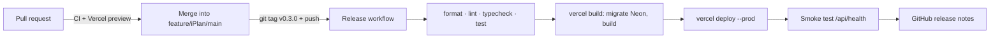

# Deploying iPlan

_ภาษาไทยแบบทีละขั้น (รวมการสมัครทุกบริการ): [DEPLOY.th.md](DEPLOY.th.md)_

Production changes only when you push a **version tag** (`v1.2.3`) from `feature/iPlan/main`.
Merging a pull request does not deploy; pull requests still get a Vercel preview link.



Everything below stays on free plans with no card. First-time account setup (Neon, Backblaze B2,
Google OAuth, Vercel project, environment variables, Gmail) is in [INFRA.md](INFRA.md#deploy-checklist-first-time);
do that first, then the one-time steps here.

## One-time setup for tag deploys

1. **Vercel project**: imported from GitHub with Root Directory `apps/web` (INFRA.md step 4).
   `apps/web/vercel.json` turns off automatic deploys for `main` and `feature/iPlan/main`, so only
   the Release workflow deploys production. Preview deploys for other branches and PRs keep working.
2. **Vercel token**: Vercel → Account Settings → Tokens → Create token `iplan-github-release`,
   scope: your account, expiry: 1 year (put a reminder in your calendar). Copy it once.
3. **Project and owner ids**: in the repo root run `npx vercel@59.23.2 link` (log in when asked,
   pick the existing `iplan` project). It writes `.vercel/project.json` (gitignored) containing
   `"orgId"` and `"projectId"`; copy both. The Project ID is also under the project's
   Settings → General.
4. **GitHub secrets**: github.com/tiphurin/iPlan → Settings → Secrets and variables → Actions →
   **Secrets** → New repository secret:

   | Secret              | Value                      |
   | ------------------- | -------------------------- |
   | `VERCEL_TOKEN`      | the token from step 2      |
   | `VERCEL_ORG_ID`     | the owner id from step 3   |
   | `VERCEL_PROJECT_ID` | the project id from step 3 |

5. **GitHub variable** (same page → **Variables**): `APP_URL` = `https://<project>.vercel.app`.
   The release smoke test and the weekly Uptime workflow use it.
6. Optional: Settings → Environments → `production` → **Required reviewers** = you, so every
   release waits for one click of approval before it touches the database.

## Releasing a version

```bash
git switch feature/iPlan/main
git pull
yarn validate                      # the same checks the workflow runs
git tag -a v0.3.0 -m "v0.3.0"      # see "Picking the number" below
git push origin v0.3.0
```

Then watch GitHub → Actions → **Release**. When it is green:

- the summary shows the deployed URL,
- GitHub → Releases has `v0.3.0` with notes generated from the merged pull requests,
- the Profile page of the live app shows `iPlan v0.3.0` at the bottom.

The workflow refuses a tag that is not `vX.Y.Z` or that points at a commit not merged into
`feature/iPlan/main`.

### Picking the number

| Change                                                  | Example         |
| ------------------------------------------------------- | --------------- |
| Bug fixes only                                          | v0.3.0 → v0.3.1 |
| New features, nothing removed                           | v0.3.1 → v0.4.0 |
| Something users rely on changes or goes away (from 1.0) | v1.4.2 → v2.0.0 |

While the app is new, stay below 1.0.0 (`v0.x.y`).

## Database migrations

Production builds run `yarn db:migrate` against Neon before building (`scripts/vercel-build.sh`).
Migrations only move forward: a release with a new migration cannot be undone by deploying an
older tag, because the older code would run against the newer schema. Before tagging a release
that contains `packages/db/migrations/00xx_*.sql`:

1. Neon → Branches → **Create branch** from `main` named `before-v0.3.0` (free, instant). That is
   your restore point.
2. Tag and release.
3. Delete the branch a few days later when all is well.

## Rolling back

- **Code only (no new migration in the bad release)**: Vercel → project → Deployments → the
  previous production deployment → **Instant Rollback**. Or GitHub → Actions → Release → **Run
  workflow** with the older tag, e.g. `v0.2.1`.
- **The bad release had a migration**: fix forward with a new patch version (`v0.3.1`). If data
  was damaged, restore from the Neon branch made before the release (Neon → Branches → Restore).

## When something fails

| Where it stopped     | Usual cause and fix                                                                         |
| -------------------- | ------------------------------------------------------------------------------------------- |
| Check the tag        | Tag on an unmerged commit or wrong format. Delete it (`git push origin :v0.3.0`) and retag. |
| Same checks as CI    | Run `yarn validate` locally, fix, merge, tag the next patch version.                        |
| Build for production | Missing Vercel environment variable or Neon unreachable; the log names it.                  |
| Deploy to production | `VERCEL_TOKEN` expired or ids wrong: renew the token and update the secret.                 |
| Smoke test           | The app started but `/api/health` failed: open Vercel → Logs; roll back if needed.          |

## Calendar subscriptions and phones

iPhone/Mac Calendar (iCloud) and Google Calendar fetch the subscription link from their own
servers, so subscriptions work only on the deployed `https://` address, not on `localhost` or a
Wi-Fi address. Test on a phone against the deployed app.
