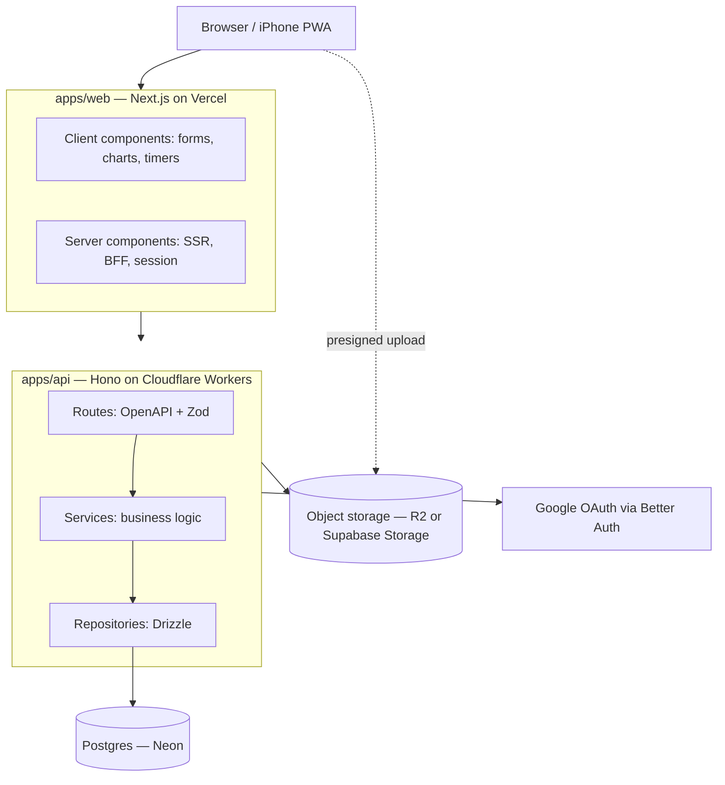

# iPlan handoff (from a Claude.ai chat, 18 Oct 2026)

## 1. Background

The owner (Tribhurin) and partner (Saowalak) built a trip app in a Claude.ai chat for a Seoul trip. It works but is a single HTML file with no build, types, tests or auth. The owner now wants a real product, built the way a senior/lead engineer would, reviewed through Pull Requests.

## 2. Legacy prototype (`legacy/seoul-trip.html`, local only) — features to carry over

- 6-day plan (prep day 22 Oct in Thai time → 27 Oct arrival), every item timed, mixed time zones (TH UTC+7 / KR UTC+9), editable/add/delete/duplicate.
- Item kinds: place, move (subway line colours), flight, task, wake, sleep. Place details: address, phone, URL, hours, budget, Naver/Google/Apple Maps links, photos.
- Live "today" screen: current item progress bar, time remaining, countdown to next item, one-tap check-in, late/early vs plan, day progress, time simulator for testing.
- Sleep/wake tracking vs planned wake time.
- Checklist (editable, grouped: documents, bookings, money & phone, packing, clothes, airport day, per day, return day) showing who ticked.
- Trip money: KRW/THB with editable rate, payer = member or shared pool, split equal / exact amounts (e.g. 2,000 meal: A pays 1,500) / percent presets, unlimited expenses per place, who-owes-whom settlement, per-day budget vs actual, category donut, T-money & cash wallet, CSV export, JSON backup/import.
- Info cards (editable): flights, hotel, clinic, lounges, emergency numbers, tips.
- Calendar: .ics export + Google Calendar links (iPhone .ics does not work inside the Claude app; works in Safari on own domain).
- Lesson learned: sharing via Claude artifacts was blocked by the owner's company workspace, so the new app must be independently hosted.

Real trip data (flights, booking references, seats, hotel, appointments) lives only in the owner's local copy of `legacy/seoul-trip.html`, which is gitignored because this repository is public. Seed data uses a fictional "Seoul (demo)" trip with the same shape: two time zones (TH UTC+7 / KR UTC+9), an overnight flight each way, a hotel, lounges and a timed appointment. The real trip is imported through the app later.

## 3. New requirements (owner's words, summarised)

1. Next.js with a clear client/server split and a real database. Explain stack, structure, architecture + diagram first; implement only after approval.
2. Multiple trips (everything in §2, generalised; N members, invite by email/link, roles owner/editor/viewer).
3. Monthly finance: recurring income (salary), deductions (withholding tax, social security, provident fund), fixed costs (phone, condo installment, rent), per-month fix/adjust overrides, one-off transactions, categories, budgets, charts that separate clearly (bar income vs expense, donut by category, trend).
4. Upload slips and photos.
5. Sign in with Google.
6. Admin dashboard: manage users (search, roles, suspend), audit log, basic stats.
7. Excellent mobile UX and performance; a good dashboard.
8. README with stack, project structure, architecture + diagram, local run, and a UI page demonstrating each feature.
9. Hosting, server and DB must be free; recommend fast and flexible options.
10. Deliver via Pull Requests to https://github.com/tiphurin/iPlan for review.

## 4. Proposed design (presented in chat)

> **Decided 17 Oct 2026.** The open decisions below were resolved; the approved architecture is in `CLAUDE.md` and `README.md`. Summary:
>
> - API: **Hono**, kept as its own package (`apps/api`) but **mounted inside Next.js at `/api/*` on Vercel**. Same origin avoids third-party cookies, which iPhone Safari blocks when web and API live on different free domains (`*.vercel.app` vs `*.workers.dev`).
> - Object storage: **Backblaze B2** (10 GB free, no card, never pauses) through the S3 API; MinIO locally. Cloudflare R2 (needs a card) and Supabase Storage (1 GB, pauses after 7 idle days) were rejected.
> - No Cloudflare account is needed. Every service is used on a free tier without a payment method.
>
> The original proposal is kept below for history.

Open decisions for the owner:

- Hono vs NestJS for the API (proposed: Hono, runs on the Workers free tier).
- Object storage: Cloudflare R2 (10 GB free, needs a payment method on file) vs Supabase Storage (smaller free quota, no card).
- Deploy the API on Workers, or as Next.js route handlers on Vercel to reduce moving parts.
- Workers free tier has a small CPU budget per request; confirm Better Auth + Drizzle fit, otherwise move the API to Vercel functions.

## 5. Accounts the owner must create (free tiers)

> Superseded: see `docs/INFRA.md`. Final list is GitHub, Vercel, Neon, Backblaze B2, Google Cloud (OAuth client only), all without a card.

GitHub, Neon, Vercel (Hobby, personal non-commercial only), Cloudflare (Workers; R2 needs a payment method), Google Cloud (OAuth client). Optional: Supabase (storage only). Local: Node 22, pnpm, Docker Desktop, GitHub CLI (`gh`).

Environment variables to expect: `DATABASE_URL`, `BETTER_AUTH_SECRET`, `BETTER_AUTH_URL`, `GOOGLE_CLIENT_ID`, `GOOGLE_CLIENT_SECRET`, `S3_ENDPOINT`, `S3_BUCKET`, `S3_ACCESS_KEY_ID`, `S3_SECRET_ACCESS_KEY`, `NEXT_PUBLIC_API_URL`, `WEB_ORIGIN`.

## 6. Earlier attempt

A first scaffold (Next.js talking to Supabase directly, RLS-heavy) was rejected as not separating client/server/API enough. Reusable ideas: pure domain functions for money/split/budget/schedule and their unit tests (recreate in `packages/core`).
